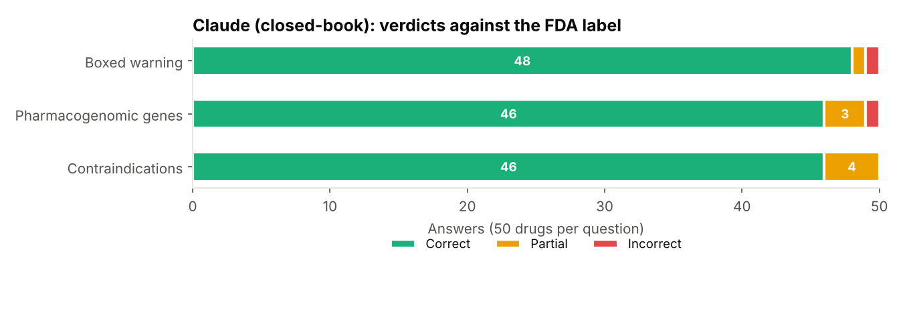
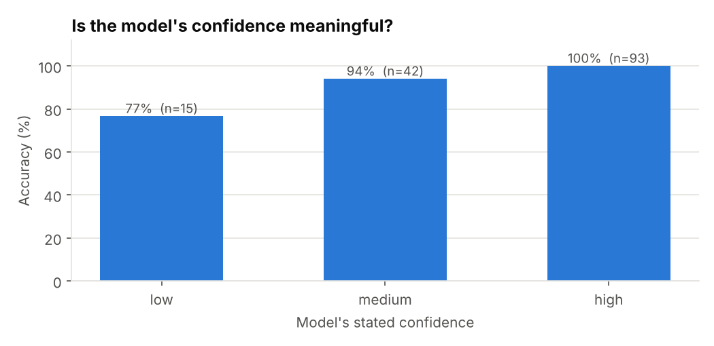

# AI Drug-Label Fact Checker

**Can you trust what an AI says about a medication?** This project checks an LLM's answers about prescription drugs against the official **US FDA drug labels**, claim by claim. Every verdict comes with the label sentence it was based on.

Most GenAI portfolio projects build a chatbot. This one builds the thing that checks the chatbot.



## What it does

For each of **50 FDA-labelled drugs**, the model is asked three questions closed-book (no label text provided) and must answer in JSON with a confidence level:

| Question | Example answer | How it's checked |
|---|---|---|
| **Boxed warning:** does the label have one, and what is it about? | `{"has_boxed_warning": true, "topics": ["QT prolongation", "sudden deaths"]}` | Presence is an exact check. Each topic must be supported by the boxed-warning text. |
| **Pharmacogenomic genes:** which genes does the label mention for use, dosing or safety? | `{"genes": ["TPMT", "NUDT15"]}` | Each gene must appear on the label (symbol or protein name, e.g. "P450 2D6" = CYP2D6, "CD20" = MS4A1). Anything else is a **hallucinated gene**. |
| **Contraindications:** what does section 4 list? | `{"items": ["severe hepatic impairment", ...]}` | Each item must be supported by the Contraindications section, and "None" must match a label that says None. |

Claim support uses transparent lexical matching: normalised clinical synonyms (MAOI → monoamine oxidase inhibitor, HBV → hepatitis B virus), light stemming, and the share of a claim's content words found in the label text. Supported ≥ 0.6, partial ≥ 0.3. No black-box judge, so every verdict can be reproduced and inspected.

## Results

Model tested: **Claude, answering closed-book** (answers in [`data/answers/claude_closed_book.jsonl`](data/answers/claude_closed_book.jsonl)).

| Question | Correct | Partial | Incorrect | Score |
|---|---|---|---|---|
| Boxed warning | 48 | 1 | 1 | 97% |
| Pharmacogenomic genes | 46 | 3 | 1 | 95% |
| Contraindications | 46 | 4 | 0 | 96% |
| **All 150 answers** | **140** | **8** | **2** | **96%** |

**Findings**

- **The model's confidence was meaningful.** Answers it marked *high* confidence were correct 100% of the time (93/93). *Medium* scored 94% and *low* 77%. A system could safely auto-answer high-confidence questions and route low-confidence ones to a pharmacist.
- **7% of named genes were hallucinated** (4 of 57). The pattern is consistent: the model names the gene behind the *disease* (HBB for sickle cell disease and beta thalassemia, CYB5R3 for congenital methemoglobinemia) when the label only names the disease.
- **Errors cluster on older or unusual labels.** It missed desmopressin's hyponatremia boxed warning, and for pravastatin it gave the newer statin-class contraindication wording rather than what this label version says.
- Every non-correct answer, with the label sentence used as evidence, is listed in [`results/REPORT.md`](results/REPORT.md).



## Making the evaluation trustworthy

An evaluation is only useful if the grader is right, so this project audits the checker as well as the model.

1. **Answers were frozen before grading.** The first commit in this repo contains only the 50×3 answers, made before the checker or label texts were examined. Drugs whose label details had been seen while selecting the sample were excluded.
2. **First-run audit found 5 checker bugs**, all in how labels are read, not in the answers. Older labels write "P450 2D6" instead of CYP2D6; "CD20" is the MS4A1 gene product; the abbreviation "TTR" also means "time to response"; one format of "None" wasn't recognised; and labels say "the drug" where an answer names it. Fixing these changed verdicts in both directions.
3. **Gene grading measures hallucination, not recall.** Labels mention dozens of genes in passing ("does not inhibit CYP1A2, CYP2C9…"), so missing those isn't an error. Missed genes are still listed in `results/claims.csv`.
4. **Manual audit of 20 verdicts** ([`results/manual_audit.csv`](results/manual_audit.csv)): all 10 non-correct verdicts plus the 10 weakest "supported" matches. The checker agreed with human review in **18 of 20 (90%)**. Both disagreements were the checker being *too strict*. For example, "secondary malignancy" vs. the label's "busulfan-induced leukemogenesis" means the same thing but shares no words. So the reported 96% is, if anything, slightly conservative.

## Run it

```bash
pip install -r requirements.txt
python src/run.py                 # grade the saved answers → results/ and images/
pytest                            # 8 tests

# Evaluate a model live (needs an Anthropic API key):
export ANTHROPIC_API_KEY=sk-ant-...
python src/run.py --live --model claude-haiku-5-5
```

Live mode asks the same three questions for all 50 drugs at temperature 0, saves the raw answers to `data/answers/<model>.jsonl`, and grades them. That makes it easy to compare models or prompts.

## Data

- **Labels:** 50 FDA Structured Product Labels (openFDA JSON, effective dates 2015–2023) from [PharmGKB/fda-labels-monitored](https://github.com/PharmGKB/fda-labels-monitored), which snapshots labels that PharmGKB annotates for pharmacogenomics. openFDA data is public domain. The 50 drugs were sampled at random (seed 2026) from 313 eligible labels.
- Label text changes over time. A "wrong" answer can be right for a newer label version, which is why each graded row records the label file and its effective date.

## Limitations and next steps

- Lexical matching is conservative on paraphrases. An optional LLM-as-judge pass for "partial" claims, audited the same way, would reduce false flags.
- 50 drugs × 3 questions is a small benchmark. The pipeline scales to all 363 labels in the source repo.
- Add a **grounded (RAG) mode** that gives the model the label section, and measure how much grounding reduces errors.

**Not medical advice.** This is an evaluation tool, not a source of drug information.

## Project structure

```
├── data/
│   ├── labels/                         # 50 openFDA label JSON files
│   └── answers/claude_closed_book.jsonl
├── src/
│   ├── labels.py      # load labels, extract boxed warning / contraindications / genes
│   ├── checker.py     # grading rules + evidence
│   ├── answerers.py   # live LLM answers (Anthropic API) + cached answers
│   └── run.py         # grade, report, charts
├── results/           # graded.csv, claims.csv, REPORT.md, manual_audit.csv
├── images/
└── tests/
```

## Tools

Python · Anthropic Claude API · pandas · Matplotlib · pytest · openFDA drug labels
